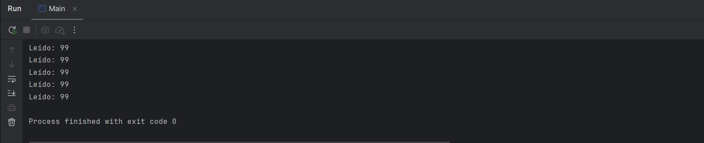
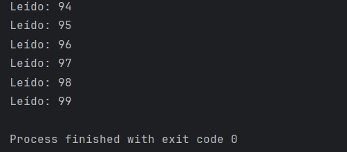

# Caso práctico 3: Programación multihilo

## Descripción

Programa en Java con 2 hebras que comparten una misma instancia de la clase `VariableCompartida`. La hebra `Escritora` modifica el valor de 0 a 99 con `set`, y la hebra `Lectora` lo lee con `get` y lo muestra por pantalla (100 valores).

## Estructura del proyecto

- `VariableCompartida.java`: guarda la variable `v` y tiene los métodos `set`, `get` e `inc`.
- `Escritora.java`: hebra que escribe los valores de 0 a 99 con `set`.
- `Lectora.java`: hebra que lee con `get` y muestra los valores.
- `Main.java`: crea la instancia compartida, lanza las dos hebras y espera a que terminen con `join()`.

## Resultado sin sincronizar

## ¿Se recogen todos los valores? ¿Qué ocurre?

No. La lectora lee 99 las 100 veces, así que de los 100 valores generados solo recoge el último.

## Justificación

- Las dos hebras trabajan sobre la misma variable sin coordinarse. La escritora es muy rápida y termina antes de que la lectora empiece a leer de verdad.
- La lectora no sabe si hay un valor nuevo, y la escritora no sabe si el anterior ya se leyó. Se pierden valores y se repiten otros.
- Es una **condición de carrera**: el resultado depende de cómo el sistema reparte el tiempo de CPU entre las hebras.
- Usar solo `synchronized` (como en el CP02) no basta: evita que dos hebras entren a la vez, pero no obliga a que se alternen.

## Solución

Se añade un indicador `disponible` y se usan `synchronized`, `wait()` y `notifyAll()`:

- `set` espera mientras haya un valor sin leer. Cuando escribe, avisa a la lectora.
- `get` espera mientras no haya un valor nuevo. Cuando lee, avisa a la escritora.

Así las hebras se turnan y se recogen los 100 valores, de 0 a 99, sin pérdidas ni repeticiones.

